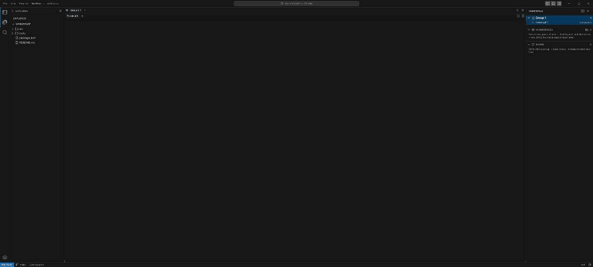

# NexTerm

A desktop terminal workspace with a VS Code shell and Warp-style terminal
ergonomics. Native [Tauri 2](https://tauri.app) window, real PTYs, React 18 UI —
macOS, Windows and Linux from one codebase.



> Two groups — `app` and `tests` — each with their own arrangement; switching
> between them, saving the whole session, and putting it back after it was taken
> apart. This is the Windows chrome (NexTerm draws its own title bar there);
> macOS keeps its traffic lights and the system menu bar.
>
> The recording is driven through the app's UI in a browser preview, so the shell
> output in it is simulated. In the packaged desktop app the same panes run real
> `zsh` / `bash` / `pwsh` / `cmd` processes.

## Why

Terminal multiplexing usually means memorising tmux bindings, and web-based
"AI terminals" cannot reach your local shell at all. NexTerm gives you a real
local PTY per pane with a layout you rearrange by dragging, and it remembers
that layout the next time you open it.

## What it does

- **A group is a whole screen.** Each group owns its own arrangement of panes,
  and the active one fills the terminal area. Click another group and its
  arrangement replaces it — the terminals you left behind keep running. Think
  of it as several desks rather than one crowded one.
- **Split panes by dragging a tab.** Drop a terminal tab on the left, right, top
  or bottom quarter of any pane to split there; drop it in the middle to move it
  into that pane. Splits nest arbitrarily and every divider is draggable, and
  where you drag a divider is where it stays — across a group switch and across
  a restart.
- **Move terminals between groups.** Drag a tab onto another group's chip, or
  use *Move to Group* in the TERMINALS panel.
- **Zoom one pane.** `⌘⇧Enter` (`Ctrl+Shift+Enter` elsewhere) makes the active
  pane fill its group and hides the rest — tmux's `Prefix z`, iTerm2's
  *Maximize Active Pane*. The hidden ones keep running; press it again and the
  split comes back exactly as it was.
- **Tidy panes.** *Equalize Splits*, *Swap Pane With…*, and a tab strip that
  steps aside for panes with one terminal.
- **See which terminal wants you.** When a program in a terminal you are not
  looking at says something, rings the bell or finishes a long command, that
  pane gets an orange ring and its tab, its group and its row in the side bar
  get a count. `⌘⇧U` (`Ctrl+Shift+U` elsewhere) goes straight to the latest
  one. A program that reports progress draws a thin bar under its tab.
- **The TERMINALS panel is a status board.** Each terminal's row says which
  agent runs in it and what it is doing, which git branch its folder is on,
  and the last thing it told you; each group's row counts what is waiting,
  running and failed. *Sort by Attention* puts what needs you first.
- **Save a group, or the whole desk.** *Save Group…* keeps one group's layout
  and each terminal's current directory. *Save All Groups…* snapshots every
  group at once under a name, and restoring it brings the entire session back —
  same groups, same arrangements, same directories.
- **Layout templates.** Give each terminal of a saved group a startup command
  and opening it starts everything at once — the dev server, the test watcher,
  the agent — each typed as soon as its shell is ready, tmuxinator-style.
- **Session restore.** Groups, layouts, names and each terminal's `cwd` are
  written to local storage and restored on next launch, without being asked.
- **Editor tabs come back too.** Each folder remembers its open files — the
  editor groups, which tab each shows, which is active — and reopens them at
  launch or when you open that folder again (up to 50 tabs, 12 folders).
  Files reopen as they are on disk; unsaved edits are not kept. A file that
  has gone, grown past 50 MB or stopped being text is dropped; one that
  cannot be read just then — locked, not allowed, a drive that does not
  answer — is left out but remembered and tried again, for up to three
  launches. Nothing waits for the tabs: they appear once their files are read
  (15 seconds at most), and if you open or type in a file before then they
  join its group instead of rearranging the editor. Settings ▸ Text Editor ▸
  *Restore Open Editors* turns it off and forgets what was saved.
- **Pick an agent conversation back up.** A terminal that was running OpenCode
  or Claude Code when NexTerm closed offers that conversation back — the one
  it had, by name — whether NexTerm started the agent or you typed it.
- **A real terminal.** xterm.js over a native PTY, with OSC 133 shell
  integration (command start/end + exit status) and OSC 7 so the status bar and
  new splits follow the shell's actual working directory. Terminals draw with
  xterm's WebGL renderer, so block and box-drawing characters — TUI logos,
  borders — fill their cells at any line height, and fall back to the DOM
  renderer where WebGL is unavailable.
- **Built for Windows' ConPTY.** The backend answers ConPTY's start-up cursor
  query (without it `cmd.exe` shows no prompt), and tells xterm.js the Windows
  build so a pane that is resized — a split, a maximised window — is not
  re-wrapped twice and does not lose lines.
- **Command suggestions.** An inline, oh-my-zsh-style ghost-text suggestion as
  you type, ranked from the commands this session has run plus a curated index
  of common ones. It is an app-side layer, not real shell completion — it never
  reads `PATH` or the filesystem.
- **11 terminal themes.** Dark Modern, Light Modern, Monokai, Material, Dracula,
  Solarized Dark/Light, Nord, One Dark, Gruvbox Dark, Tomorrow Night.
- **An editor when you need one.** Open a file from the Explorer and it appears
  as a Monaco tab above the terminals; close it and you are back to a pure
  terminal window. Monaco is loaded the first time the editor is shown, not at
  launch, and it and its workers are bundled locally — nothing is fetched from a
  CDN at runtime.
- **Opens with no folder, like VS Code.** NexTerm starts with nothing open;
  the Explorer offers *Open Folder*. Until a folder is open, terminals start in
  your home directory.
- **Filesystem confinement.** Every file command is resolved against the open
  folder, with the deepest existing ancestor canonicalised so symlinks cannot
  escape it. With no folder open, file commands are refused outright.
- **One title row.** On Windows and Linux the window is frameless and NexTerm
  draws its own compact title bar — a ☰ application menu, the folder name,
  command centre, layout toggles and window buttons in a single 35px row, VS
  Code style, instead of a native title bar with a native menu bar under it.
  macOS keeps its traffic lights and the system menu bar.

## Install

Grab a build from the [Releases](../../releases) page:

| Platform | File | Notes |
| --- | --- | --- |
| macOS (Apple Silicon) | `NexTerm_<version>_aarch64.dmg` | Unsigned — first launch needs right-click → Open, or `xattr -dr com.apple.quarantine /Applications/NexTerm.app` |
| Windows — installer | `NexTerm_<version>_x64-setup.exe` / `_x64_en-US.msi` | Installs WebView2 if missing (needs internet on first run) |
| Windows — portable | `NexTerm-windows-x64-portable.zip` | Unzip and run `NexTerm.exe`, no installation |
| Linux (x86_64) | `.AppImage` / `.deb` / `.rpm` | Built on Ubuntu 22.04 |

There is no Intel macOS build yet — CI runs on `macos-latest`, which is Apple
Silicon. Build one locally with `npm run tauri build -- --target x86_64-apple-darwin`.

## Using it

The recording above walks through most of this.

**Open a folder.** NexTerm starts with no folder. Click *Open Folder* in the
Explorer, or ☰ → File → *Open Folder…*. The Explorer, the title bar and new
terminals then follow that folder.

**Be told when something finishes.** A command that runs for more than ten
seconds in a terminal you are NOT looking at puts an entry in the status bar's
bell — name, exit code, how long it took — and clicking it takes you to that
terminal. Nothing is said about a command you watched finish, and nothing is
said about a quick one; the threshold is Settings ▸ Terminal ▸ Notify After,
and 0 turns it off.

**Search across the files.** `⇧⌘F`, or the magnifying glass in the activity
bar, opens a search over the open folder — match case, whole word, regular
expressions — grouped by file, and clicking a result opens that file with the
caret on the line. It skips exactly what the Explorer skips (`node_modules`,
`.git`, `target`, `dist`), so the results and the tree agree about what is in
the project; `.gitignore` itself is not read. Searching happens on `Enter`, not
on every keystroke: a grep of a real repository is not something to fire on the
`e` of `error`.

**Narrow the Explorer.** The funnel in the Explorer header opens a filter: type
part of a name and the tree keeps only what matches, plus the folders that lead
to it, opened. It counts the matches, `Esc` clears it, and clearing puts your
own expanded folders back exactly as they were. This is a different question
from ⌘P — "what is in here that looks like X, and where does it sit".

**Delete to the Trash.** Delete in the Explorer moves files and folders to the
Trash — the Recycle Bin on Windows — where they can be restored. Where that is
not possible or cannot be checked — a network drive, a USB stick, an item too
big for the Recycle Bin, a drive whose Recycle Bin is turned off — nothing is
deleted until a second question, *Delete Permanently?*, opens with Cancel
focused. On Windows and Linux a link is removed as a link and what it points to
stays; on macOS it goes to the Trash. Settings ▸ Files ▸ *Enable Trash* turns
it off.

**Go back to a folder you had open.** `⌥⌘O`, File → *Open Recent…*, or the
list the Explorer shows when nothing is open. A folder that has since been
moved or deleted is refused by the backend and drops out of the list rather
than staying as a row that fails every time it is clicked.
**Pick a shell per terminal.** Right-click a group in the TERMINALS panel →
*New Terminal With ▸* lists the shells this machine actually has — found on the
real box rather than guessed, so it names Git Bash and WSL when they are there
and does not offer PowerShell 7 when they are not. Terminals in one window may
differ, the status bar names the one you are looking at, and *Duplicate* keeps
a terminal's shell as well as its directory. Settings ▸ Terminal ▸ Default
Shell picks what a plain new terminal opens, and still takes a typed path.

**Open a terminal.** The window starts as one group holding one terminal.
`⌃⇧\`` adds a tab to the current group; the `+` in the tab bar does the same.

**Split.** Use the split buttons in the panel header, `⌘D` (right) / `⌘⇧D`
(down), or drag a tab onto an edge of any pane. While dragging, the target
quarter lights up so you can see where it will land before you let go. A
split carries on from the terminal being split: it opens in that terminal's
current folder, in the same shell — a Git Bash split stays Git Bash, in the
same directory. Settings ▸ Terminal ▸ *Split Directory* makes splits start
like any new terminal instead (VS Code's `terminal.integrated.splitCwd`).

**Even out and rearrange panes.** *Equalize Splits* in the command palette
gives every pane of the group the same share, nested splits included, and
Settings ▸ Terminal ▸ *Equal Splits* does it on every new split. *Swap Pane
With…* in the palette, or in a pane's menu, lists the other panes of the group
and trades places with the one you pick: the terminals move as they are,
programs and scrollback included, and the cursor stays in yours. It is
unavailable while a pane is zoomed, since the other panes are hidden.

**Hide a lone tab strip.** With Settings ▸ Terminal ▸ *Hide the Tab Strip of a
Single Terminal* on, a pane with one terminal shrinks its strip to a thin
handle along the top, and the terminal gets the rest of the row. The handle
marks an unread entry, progress and a password lock, and says which in its
tooltip. Click it and the strip opens just below it, over the terminal; click
the handle again, click elsewhere, or press Escape while the strip has the
keyboard to close it. Escape typed in the terminal is the program's, as it
always is: it does not close the strip. The opened strip has no close buttons,
so a click that misses the handle cannot end a terminal: close it from the
handle's right-click menu, the command palette or `⌘W`. The strip also opens
while you drag a tab, so you can still drop one there, and while its menu or
rename is open. Pointing at the pane never opens it, so a click meant for the
terminal's first row always reaches the terminal, and the terminal is never
resized by it. A second tab brings the full strip back.

**Zoom a pane.** In a split group, `⌘⇧Enter` (`Ctrl+Shift+Enter` on Windows
and Linux), the ⤢ button in a pane's tab strip, Terminal → *Toggle Pane Zoom*
or the command palette makes that pane fill the whole group. The other panes
are hidden, not closed: what runs in them keeps running, a program that asked
is told its terminal lost focus, and the pane's tab strip carries a *Zoomed*
chip — click it, or press the chord again, and the split comes back exactly as
it was, sizes and all. The terminal that grows or shrinks is told its new size,
so a full-screen program redraws for it. A zoom ends by itself when it would
stop making sense: the zoomed pane closes, you split, you move to another pane
(`⌥⌘←` / `⌥⌘→`, or a hidden terminal in the TERMINALS panel), or a terminal is
moved into a pane the zoom hides — the way tmux unzooms. Each group keeps its
own zoom while you switch between them (its chip shows ⤢); a restart comes back
with every pane in view.

**Work in groups.** The chips above the terminals are your groups; `+` makes a
new one. Clicking a chip swaps the whole arrangement to that group's. Set up
one group for the app and another for tests, and switch between them instead of
cramming both onto one screen.

**Move a terminal to another group.** Drag its tab onto the target group's chip,
or right-click it in the TERMINALS panel → *Move to Group*.

**Click what the output names.** A stack trace's `src/app.js:42:13`, a
compiler's `--> src/main.rs:10:5`, a Python traceback's `File "x.py", line 9` —
click it and the file opens in the editor above with the caret on that line.
Relative paths are read against the terminal's current directory, not the
workspace root, so a `cargo` run inside `src-tauri/` lands on the right file.
`http://` and `https://` addresses open in your browser; nothing else is ever
offered as a link, and a path without a line number is left as plain text so
ordinary output does not fill up with underlines.

**Show a listed file or folder in Explorer or Finder.** Hold `Ctrl` (`⌘` on
macOS) and point at a name in the output — from `ls`, `ls -l`, `dir`, `find`
or `git status` — and it is underlined if it exists; click and Explorer or
Finder opens that folder, or the file's folder with the file selected (on
Linux a folder is shown selected in the folder above it). A file is never
opened or run, and an app bundle is shown, not launched. A name is read
against the directory the terminal was in when the line was printed, and
against `dir`'s ` Directory of …` heading above it. Where NexTerm knows the
command — zsh, bash and PowerShell report it, and cmd's prompt line shows it
— it also follows an `ls -R` heading and the one folder an `ls` or `dir` was
given, and offers no names at all in output from `ssh`, `docker exec` or
`wsl`, which are another machine's. Nothing is looked up until the key is
held, and plain clicks and selection work as before.

**See what the other terminals are doing.** A tab shows a blue dot while a
command is running in it and a red one when the last command failed, and a
group's chip shows the same for every terminal inside it. The point is the ones
you are not looking at: switching groups replaces the whole arrangement, so
without this a build finishing — or failing — in another group is invisible.
Hovering says it in words. Nothing flashes for an empty prompt line.
**Know which command you are scrolled into.** Scroll back through a long build
and a small header appears at the top of the pane naming the command whose
output you are looking at. It is gone at the bottom, where the header would
only repeat what is on screen, and never appears over a full-screen program
like vim or htop. Settings ▸ Terminal ▸ *Sticky Command Header* turns it off —
it covers the top row, which is occasionally the row you scrolled up to read.
**Run something again.** `⌘⇧H` opens the command history: every command line
this machine has run, newest first, with the directory it ran in. Typing
narrows it by plain substring — a command line is not a filename — and `Enter`
types the chosen one into the active terminal without pressing return, so a
command from yesterday can be edited before it runs. The history outlives the
window. It is **not** on `Ctrl+R`: that is reverse-i-search in every shell, and
a history palette that costs you the shell's own is a bad trade.

**Select, copy and paste — the way Warp does it.** Drag over any text to
select it; double-click takes a word, triple-click a line. The selection is on
the clipboard the moment you let go (Settings ▸ Terminal ▸ *Copy on Select*
turns that off). This works inside Claude Code too: a program writing into the
scrollback never gets the mouse, even when it asks for it, so a drag there
selects. A **full-screen** program — vim, htop, tmux, `less --mouse`, anything
on the alternate screen — does get the mouse when it asks; hold **Shift** while
dragging to select inside it anyway (on macOS **⌥** works too). *Mouse
Reporting in Full-Screen Apps* in the same section takes the mouse away from
every program. Paste with `⌘V` on macOS, `Ctrl+V` on Windows — see the table
below. A program that asked for bracketed paste gets the text bracketed, so a
multi-line paste into a shell or an agent is not run line by line.

**Pasting several lines asks first.** A paste of two or more lines into a
program that has not asked for bracketed paste — cmd never does, so each line
would run as it arrives — asks *Paste*, *Paste as One Line* or *Cancel*, with
Cancel focused so a habitual Enter does not run it. Lines of only spaces do
not count, and a paste that carries an escape sequence is always asked about;
bracketed-paste markers are stripped from everything pasted, so a pasted
`ESC[201~` cannot end the bracket early and run what follows. Settings ▸
Terminal ▸ *Multi-Line Paste Warning*: Auto, Always or Never.

**A lock marks a password prompt.** On macOS and Linux, while a program in a
terminal reads input without showing it — `sudo`, `ssh`, `read -s`, a
password prompt — its tab, its row in the TERMINALS panel and, with the tab
strip hidden, the pane's handle show a lock: "Typing is hidden (password
prompt)". NexTerm tells this from the terminal's own settings: input that is
neither shown nor read a line at a time is how every shell's line editor and
every full-screen program works, so only hidden input read line by line
counts. While the lock is on, nothing NexTerm types for you goes into that
terminal — a layout's startup command, an agent's start or resume, the answer
to cmd's batch-job question. It waits for the prompt to be answered, and if
the terminal is still asking when the wait runs out, it is not typed and the
terminal says why. What you type and paste is never held back, so a password
manager still works. Windows gives no way to read this from outside a console
program, so there is no lock on Windows.

**Drop a file to type its path.** Drag files or folders from Windows Explorer
or Finder — or a row from NexTerm's own Explorer — onto a terminal, and their
full paths are typed into that pane's active terminal: quoted only when
needed and the way its shell reads them (`"…"` for cmd, `'…'` for PowerShell
and bash), one space between them, no trailing space, nothing run. Git Bash
and Cygwin get `C:/…`, WSL gets `/mnt/c/…`. It arrives as a paste, so a
program that asked for bracketed paste — OpenCode, Claude Code — gets one
paste, not keystrokes. The pane lights up while something is over it;
dropping anywhere else does nothing, and nothing is ever moved or copied. A
name holding a newline or another control character is left out rather than
typed, because in a shell without bracketed paste it would run whatever
followed. In a shell NexTerm does not recognise, only paths that need no
quoting are typed.

**Find something in the scrollback.** `⌘F` opens a find bar over the focused
terminal — incremental as you type, `Enter` / `Shift+Enter` to walk the matches,
`Esc` to close. Match case, whole word and regular expressions are there, every
match is highlighted at once, and the bar counts them ("3 of 17"). The buffer is
5000 lines deep by default, so this is how you get back to the error that
scrolled past.

**Make the text bigger.** `⌘=` and `⌘-` step the terminal and editor font
together, `⌘0` puts them back. While the size is not the default, the status bar
says so and clicking it resets.

**Rename.** Double-click a terminal tab, or right-click it → *Rename*. Groups
rename the same way, from their chip or from the TERMINALS panel.

**Save a group.** Right-click a group in the TERMINALS panel → *Save Group…*.
It lands under SAVED with its terminal count and age; right-click it to *Load
in New Group* or *Load into Current Group*.

**Layout templates.** A saved group whose terminals have startup commands is a
layout template: open it and each terminal types its command the moment its
shell has drawn its first prompt — the same wait NexTerm uses before typing an
agent, so nothing is typed ahead of the prompt and echoed twice (a shell that
never reports its prompt, like fish or sh, gets it after three seconds). It is
typed as you would type it, with `Enter`, in zsh, bash, PowerShell or cmd
alike — in the default shell, since a saved group does not remember which
shell each terminal ran. Right-click the saved group → *Edit Startup
Commands…* lists its terminals with their directories and a command field
each; empty means just a shell. Saving a group fills these in for you from
what is **running** in each terminal at that moment — `npm run dev`, a test
watcher, `claude` for Claude Code, or `opencode -c` for OpenCode, which
continues the folder's latest conversation — and leaves a terminal sitting at
a prompt empty: the last command of an idle shell is what
it did, not what it is for, and opening the template would run it again. A
saved row with startup commands shows ▶ and how many, and its tooltip lists
what opening it will run.
Each command is one line — join several with `&&` or `;` — and a multi-line
paste is refused with a message rather than run line by line; control
characters are stripped. Saved workspaces work the same way (the workspace bar
→ *Edit Startup Commands of a Saved Workspace…*), and restoring one starts
every group's commands. Restoring the session at launch never runs anything: it
brings the shells back, as it offers an agent back rather than starting it.

**Pick an agent conversation back up.** Quit NexTerm while OpenCode or Claude
Code runs in a terminal, and that terminal comes back offering the
conversation: *Resume* types the command that continues it. Nothing starts by
itself — an agent spends tokens — and the terminal's scrollback is not
restored, only the conversation inside the agent. It works for an agent you
typed yourself (`opencode`, `opencode -c`, `claude`, `claude --resume <id>`) as
well as one started from a pane's menu (right-click the empty part of its tab
strip → *New opencode Terminal* / *New Claude Code Terminal*); a line that
does more than start the agent (`cd x && opencode`, a pipe) is not followed.
Claude Code's conversation is always the exact one. OpenCode chooses its own
ids, but names the conversation it shows in the terminal's title; NexTerm looks
that title up with `opencode session list`, run in the terminal's own folder
(so conversations in a git repository are found), while it runs — again if
that fails — and when *Resume* is pressed. *Resume* then types
`opencode -s <id>`, never a conversation another terminal has. When NexTerm
cannot tell which conversation a terminal had — two terminals showing the same
title before either knew its id, for instance — it types nothing, says why,
and opens *Choose…* in the active pane, where conversations other terminals
hold are greyed out; the list opens without taking the keyboard from the
terminal. `opencode --continue` (the most recent conversation in the folder or
below — a whole repository from its root) is typed only when the list cannot
say which and no other OpenCode terminal is open, offered or resumed (and
still open) in the same folder, a folder above it or one below it; if the list
cannot be read at all, the offer shows OpenCode's own reason.

**When a shell exits.** A terminal whose shell has ended says so once —
`[process exited with code …]`, with Windows' crash and Ctrl+C codes also in
hex (`0xC000013A, ended by Ctrl+C`) — and **Enter** starts a new shell in its
place: same pane, its last directory, the shell it ran, at the top of the pane
with what was on screen moved up into the scrollback. Other keys go nowhere
instead of each printing an error, and whatever the last program had switched
on (mouse reporting, the full-screen view) is switched off, so a drag selects
text again. On Windows this is how a terminal comes back when quitting
OpenCode with Ctrl+C took cmd down with it, as has been seen; the code it
prints says how cmd ended.

**cmd's "Terminate batch job (Y/N)?" is answered for you.** OpenCode runs in
cmd through `opencode.cmd`, so Ctrl+C out of it makes cmd ask that question,
and a second Ctrl+C at it can end cmd itself. In a cmd terminal, after your
Ctrl+C, NexTerm types `Y` for you — only for cmd's own question (its `^C` beside
it, or its English or Korean wording), only one that appeared after the Ctrl+C,
and only until you type something else. Settings ▸ Terminal turns it off.

**Save the whole session.** The 💾 on the WORKSPACES section (or *Save All
Groups…* from the empty-area menu) snapshots every group — layouts and
directories included. Double-click a saved workspace to put the session back
the way it was, or right-click → *Add Its Groups to This Session* to bring them
in alongside what you already have.

**Open a file.** Click a file in the Explorer. The Monaco editor opens above the
terminal panel as a normal tab; the terminals keep running underneath.

**Use the menu.** On Windows and Linux, ☰ at the left of the title bar opens
File, View and Terminal. Hover or use the arrow keys to step into a menu,
`Enter` to run an item, `Esc` to back out; keys typed while it is open never
reach the terminal behind it.

**See what git sees.** When the open folder is a repository, the status bar
carries the branch, how far it is from upstream and how many files have
changed, and the Explorer colours the ones that have — modified, added,
deleted, untracked — with a letter beside each, so the row still says something
where the colours do not. It shells out to your own `git`, which is what makes
worktrees, submodules and your own `core.*` behave here the way they behave in
the terminal below. There is no staging or committing: that is a second
application, and this one has git in it already.

**Change settings.** The gear in the activity bar opens a VS Code-style settings
window — editor font, terminal font/size/line-height, cursor style and blinking,
scrollback, colour theme, command suggestions, copy on select, what a
right-click does, and mouse reporting.

**Pick or import a terminal theme.** Settings ▸ Terminal shows every terminal
theme as a card with its colours. Point at a card, or move to it with the arrow
keys, and every terminal shows it at once; Escape, moving away or closing
Settings puts your theme back, and a click or Enter chooses it. *Import
Theme…* reads a theme you pick and switches to it: a Ghostty theme file, a Windows Terminal colour scheme
(`.json`, one scheme or a `schemes` list to choose from) or an iTerm2
`.itermcolors` file. Up to 20 imported themes sit beside the built-in ones and
can be deleted (with an undo); colours a file leaves out come from NexTerm's own. A theme with a
light background is refused, because the rest of NexTerm is dark, and so is
a file that is too large, has a colour NexTerm cannot read, or carries XML
declarations other than the one iTerm2 always writes. The import says which.
Imported themes are settings, so *Reset All* removes them too, and asks first
when there are any.

### Notifications from programs

A program can ask its terminal to tell you something: OpenCode when a session
is done, needs permission, has a question or fails; Claude Code when it needs
permission or is waiting for you. NexTerm understands the three ways programs
ask — OSC 9 (iTerm2's), OSC 99 (kitty's) and OSC 777 (Ghostty's) — and puts
what they say in the status bar's bell, unless it came from the terminal you
are typing into. While NexTerm is in the background it also shows a desktop
notification. Clicking the entry in the bell takes you to that terminal. One
terminal is heard at most once every two seconds and ten times a minute; the
rest is dropped. Settings ▸ Terminal ▸ *Notifications from Programs* turns it
all off.

Neither program does this until you tell it to:

- **OpenCode** — in `~/.config/opencode/tui.json`:

  ```json
  { "attention": { "enabled": true } }
  ```

  It notifies only while its terminal is not the one you are typing into, and
  plays its own sound. NexTerm sets `OPENTUI_NOTIFICATION_PROTOCOL=osc99` in
  every terminal, unless you set it yourself, so OpenCode sends OSC 99 even
  where the answer to its start-up question cannot get back to it.
- **Claude Code** — `/config` → notifications → *Kitty (OSC 99)*, which is the
  `preferredNotifChannel` setting (`kitty`). *iTerm2 (OSC 9)* and *Ghostty (OSC
  777)* work too. The default, *Auto*, picks by the terminal's name and has
  nothing for NexTerm, so it stays silent.
  *Terminal Bell* works as well, but only inside the app: a bell rings the
  terminal for your attention (see below) and never makes a desktop
  notification.

A desktop notification needs the operating system to allow it — on macOS
System Settings ▸ Notifications, on Windows Settings ▸ System ▸ Notifications,
on Linux a running notification service. On Windows, toasts are for the
installed app (the `setup.exe` or `.msi`): Tauri's notification plugin, which
shows them, documents its Windows support as working only for installed apps.
The portable `NexTerm.exe` is not installed, so do not count on a toast from it.
The bell works everywhere either way.

### Which terminal wants you

Every entry in the status bar's bell belongs to a terminal, and stays unread
until you look at that terminal: it is the active one while the NexTerm window
has focus. While it is unread you can see it from anywhere:

- **An orange ring** around the pane that holds the terminal. It pulses unless
  motion is reduced (Settings ▸ Workbench, or the operating system's own
  setting).
- **A count** on the terminal's tab, on its group's chip and on its rows in the
  TERMINALS side bar.
- **The bell's number** is how many entries are unread. Unread ones are bold,
  read ones are dimmed, and the bell turns red when an unread one is a failed
  command. *Mark all read* and *Clear all* are at the top of the list.

`⌘⇧U` (`Ctrl+Shift+U` on Windows and Linux) goes to the newest unread entry's
terminal, in whatever group or pane it is, and puts the cursor there.
*Go to Latest Unread Notification* and *Mark All Notifications Read* are in the
command palette too, and both can be given other keys in Settings ▸ Keyboard Shortcuts.
On Linux the input method (IBus) may take `Ctrl+Shift+U` for itself; bind
another key if it does nothing.

Three things make an entry: a long command finishing (see *Be told when
something finishes*), a program's notification (above), and the terminal bell
— the `BEL` character a program prints, which Claude Code's *Terminal Bell*
channel sends. Repeated bells from one terminal add up in one entry, and a bell
is never a desktop notification. Settings ▸ Terminal ▸ *Terminal Bell* turns
bells off. Nothing is recorded for the terminal you are typing into; with
*Flash the Terminal You Are In* on, its ring flashes once instead.

**Progress.** A program can report how far along it is with OSC 9;4, the
sequence Windows Terminal and ConEmu understand. NexTerm draws it as a thin bar
under the terminal's tab — blue while it runs, red for an error, yellow when
paused, a sliding segment when the program cannot say how far. The group's
chip, and on Windows the taskbar button, show one bar for several terminals: an
error wins over a pause, a pause over normal progress, and among equals the one
furthest behind is shown. The bar goes when the program says so, when the
command ends or when the shell exits. A shell that never reports its prompt,
like fish or sh, or one inside ssh, cannot say that a command ended, so there a
bar the program leaves behind stays until the next one replaces it or the shell
exits. Some programs send OSC 9;4 only when they believe they are in Windows
Terminal, so not every program that shows progress there will show it here.
Settings ▸ Terminal ▸ *Progress Bars* turns it off. To try it:

```sh
printf '\033]9;4;1;40\033\\'; sleep 5
```

One limit applies to all of this: a terminal is read only once it has been on
screen. A background tab of a restored session that you have not opened since
launch raises nothing until you first show it, and what it printed before that
is replayed as history, without bells or progress.

### The TERMINALS panel as a status board

Each terminal's row in the TERMINALS side bar has two lines. The first is the
one it always had: its name, its unread count and its folder. The second says
what it is doing right now:

- **The agent and its state.** *Claude Code* or *OpenCode* when one runs in
  the terminal, then a state, always as a symbol and a word: *Waiting* when it
  has an unread entry in the bell (that is the only thing that means waiting —
  nothing is guessed), *Error*, *In progress 40%*, *Paused 40%* and *Working*
  from the program's progress report, *Running* while a command runs,
  *Failed* when the last one exited with an error, *Exited* when the shell is
  gone.
- **The git branch of its folder**, or *detached* and the commit when the head
  is detached.
- **The last notification**, dimmed once read. Hover it for the whole text
  and how long ago it came.

Each group's row counts its terminals that are waiting, running and failed,
and a group chip says the same when you hover it.

The branch is read from the folder's `.git/HEAD` file. No git program runs
for it, so nothing a repository configures can run, and there is no process
per terminal. It is read again when the terminal changes folder, when a
command ends in any terminal of the same repository, when the open folder's
git status changes, when the terminal's program sends a notification or rings
the bell, and when you switch to the terminal; it is never polled. There is
no branch for a folder on another machine (a network share or a mapped network
drive, including one reached through a link), for a WSL terminal (Windows
reaches WSL's files over the network), for a repository in git's newer
reftable format, for a `.git` that cannot be read, or for a branch whose name
hides invisible characters. A lookup that takes longer than three seconds
shows no branch, and that folder is not asked again until the first answer
has come back.

**Sort by Attention**, the button in the panel's header or Settings ▸
Terminal, lists waiting terminals first, then failed ones, then running ones,
in each pane and across groups. It only changes what is shown: turn it off and
your own order is back, and menu items that act on your order, such as *Close
Terminals to the Right*, are unavailable while it is on. The order holds still
while you aim: while the pointer is on a row, from a press until its click and
a possible double-click are done, while a menu from the list is open and while
you rename a row. A dot on the sort button says the list is waiting to
re-sort; moving the pointer off the rows or switching to another app lets it
catch up at once.

Settings ▸ Terminal has *Show Folder*, *Show Git Branch*, *Show Agent and
Status* and *Show Last Notification*. With the last three off, rows are one
line again.

### Keyboard shortcuts

| Shortcut | Action |
| --- | --- |
| `⌘K` | Command palette |
| `⌘P` / `⌘⇧P` | Go to file / all commands |
| `⌘⇧F` | Search across files |
| `⌘⇧O` | Open a folder |
| `⌥⌘O` | Open a recent folder |
| `⌘,` | Settings |
| `⌃\`` | Toggle the terminal panel |
| `⌃⇧\`` | New terminal tab in the current group |
| `⌘D` / `⌘⇧D` | Split the active pane right / down |
| `⌘W` | Close the active terminal pane |
| `⌘⇧W` | Close the window |
| `⌥⌘←` / `⌥⌘→` | Focus the previous / next pane |
| `⌘⇧Enter` | Zoom the active pane / show every pane again |
| `⌘⇧U` | Go to the latest unread notification's terminal |
| `⌘B` | Toggle the primary sidebar |
| `⌥⌘B` | Toggle the terminals side bar |
| `⌘L` | Clear the active terminal |
| `⌘F` | Find in the active terminal's scrollback |
| `⌘⇧H` | Command history |
| `⌘=` / `⌘-` / `⌘0` | Bigger / smaller / default text |
| `⌘S` | Save the active editor file |

On Windows and Linux use `Ctrl` wherever `⌘` is listed. That is the table out
of the box — every row is rebindable.

Copy and paste in a terminal follow each platform's own terminal, and are not
in the table above (they are not rebindable):

| | Paste | Copy the selection |
| --- | --- | --- |
| macOS | `⌘V` | `⌘C` (or just select — see *Copy on Select*) |
| Windows | `Ctrl+V`, `Ctrl+Shift+V`, `Shift+Insert` | `Ctrl+C` **while something is selected**, `Ctrl+Shift+C`, `Ctrl+Insert` |
| Linux | `Ctrl+Shift+V`, `Shift+Insert` | `Ctrl+Shift+C`, `Ctrl+Insert` |

On Windows this is Windows Terminal's table: `Ctrl+C` with nothing selected
still interrupts, and copying clears the selection so the next `Ctrl+C` does
too. `Ctrl+V` pastes text rather than sending `^V` — Claude Code pastes an image
with `Alt+V` there, and vim's block selection is `Ctrl+Q`, as in gvim.

**Right-click copies or pastes**, as in Windows Terminal: with a selection on
screen it copies it and clears it, otherwise it pastes — text as `Ctrl+V` does,
and an image alone as the empty paste that tells OpenCode to attach it. It does
so inside Claude Code, OpenCode and vim as well, which never see the click.
`Shift`+right-click passes the click on to the program instead — on macOS;
elsewhere xterm keeps a Shift-click for selecting, so there it does nothing.
On by default on Windows; Settings ▸ Terminal ▸ *Right Click* turns it on
(*Copy or Paste*) or off (*Default*) on any platform.

**Changing a shortcut.** Settings ▸ Keyboard Shortcuts lists every command,
records the chord you press, and unbinds or resets one per row. Conflicts are
reported rather than resolved: two commands on one chord is called out, not
silently decided by which came first. What you change follows through to the
menus — the native menu bar on macOS and the ☰ menu on Windows and Linux both
print the key that actually runs the command, and the command palette shows it
too.

One thing rebinding will not do is take a control character away from the
shell. Bind something to `Ctrl+D` and the command runs from the keyboard, but
no menu item registers it as an accelerator — the window resolves its
accelerators before the terminal ever sees the key, so registering `Ctrl+D`
would cost every pane in the app its EOF. The menu shows that row without a
shortcut.

**Shortcuts yield to the shell, with a few exceptions.** A chord the terminal
needs goes to the terminal: with a pane focused, `Ctrl+D` is EOF, `Ctrl+K`
kills to end of line, `Ctrl+C` interrupts (on Windows, unless text is selected
— then it copies), `Ctrl+R` is reverse-i-search, and the app does nothing. The
same chord elsewhere in the window does what the table says.

The exceptions are the shortcuts that would be useless if they stopped working
whenever a terminal had focus — which is this app's resting state. The app
claims these ahead of xterm:

- the side-bar toggles, `⌘B` / `Ctrl+B` and `⌥⌘B` / `Ctrl+Alt+B`; otherwise
  xterm turned `Ctrl+B` into `^B` and the shortcut the menu advertises did
  nothing at all
- find, `⌘F` / `Ctrl+F`
- the zoom keys, which are punctuation and a digit and cost the shell nothing
- pane zoom, `⌘⇧Enter` / `Ctrl+Shift+Enter`. xterm sends `Ctrl+Shift+Enter` as
  a plain `Enter`, so a shell gives nothing up; a program that turned on
  *modifyOtherKeys* (OpenCode, see below) would have received it as a key of
  its own off macOS, and binds nothing to it. Inside the editor `⌘⇧Enter` stays
  Monaco's *Insert Line Above*

VS Code makes the same trades with the same keys. Two of them do take something
away on Windows and Linux, where `⌘` is `Ctrl`: **`Ctrl+B` will not reach tmux**
(rebind tmux's prefix, or rebind the toggle) and **`Ctrl+F` no longer moves the
cursor forward in readline** (the arrow keys still do). Both rows are rebindable
in Settings ▸ Keyboard Shortcuts. On macOS nothing is given up — `⌘` never
reaches the pty. Everything else in the table above is left to the shell.

**`Shift+Enter` for a newline in OpenCode.** A program that turns on xterm's
*modifyOtherKeys*, as OpenCode does, gets `Shift+Enter` and `Ctrl+Enter` as
keys of their own (`CSI 27;2;13~`, `CSI 27;5;13~`), so they insert a newline
there instead of submitting. Where nothing asked for that — the shell, Claude
Code — they are plain `Enter`, as before. `⌥Enter` / `Alt+Enter` sends
`Esc Enter` either way.

Packaged builds also refuse the reload chords (`F5`, `Ctrl+Shift+R`, `⌘R`).
Reloading restarts the frontend, and start-up reaps every terminal the backend
is holding, so a stray reload would kill every running shell. Development
builds still reload, because that is the point of them.

## Develop

```sh
npm install
npm run tauri dev        # native window, hot-reloaded frontend
npm run dev              # frontend only, in a browser, on :1420
```

## Build

```sh
npm run tauri build
```

CI (`.github/workflows/build.yml`) runs the test suite on every push and builds
macOS, Windows and Linux bundles. Publishing is a separate, tag-only job:
pushing a `v*` tag creates the release as a **draft**, checks that all eight
expected assets are present and non-empty, uploads them, reads them back from
the API to confirm the sizes match, and only then makes the release visible.
A build that loses a platform leaves a draft behind instead of a half-finished
public release.

CI runs the tests on all three platforms, not just Linux. That matters because
the Rust suite spawns real shells, opens real PTYs and reads real directories,
so it behaves differently on each: ConPTY is not a unix pty, and
`C:\Users\me\project\src` is not a path that any `/`-shaped assumption
survives. The Windows job also reads the PE header of the binary it just built
and refuses anything that would open a console window beside the app.

## Test

```sh
cd src-tauri && cargo test    # PTY, ConPTY start-up, OSC parsing, fs confinement, native menu
cd ..
node tests/e2e/runner.js      # store + UI flows against a mock IPC bridge
node tests/adversarial/runner.js
```

Run `cargo test` **first**: it reads a real directory tree and writes what the
backend returned to `tests/fixtures/backend-tree.json`, which the adversarial
suite then pushes through the real explorer code. That pair is how a Windows
path is checked against the explorer on Windows rather than against a
hand-written string. Without the fixture those cases report as `SKIPPED`
rather than passing, so a run that checked nothing cannot look like a run that
checked everything.

## Verify on Windows

NexTerm is built on a Mac and used on Windows, and the suites cannot close
that gap on their own. Three consecutive releases fixed bugs that appear
**only on Windows**, and each shipped with every test on every platform
green — a title bar drawn twice, a folder dialog holding the event-loop
thread, a default shell that never reported its directory, a console window
flashing on every save. None of them returns an error; they are appearances,
and the code is correct on the machine that wrote it.

So a release is checked by hand on Windows, against a written list, with
evidence. [**WINDOWS_VERIFICATION.md**](WINDOWS_VERIFICATION.md) has the
procedure: the twelve checks, what each one is pinning and why it was not
caught, and the PowerShell helpers that make them evidence rather than
impressions — a screen capture (which works there and does not on the build
machine), the window's frame read as style bits rather than pixels, and a
`conhost.exe` count that catches a console flash too brief to see.

Two rules from it are worth repeating here, because both turn a real check
into a vacuous one:

- **Do not clear `%APPDATA%\com.nexterm.ide\.window-state.json` first.**
  Whether the app is right *with that file still in place* is exactly what is
  being checked; the fix was to stop reading the value so that nobody has to
  delete anything.
- **"Could not check" is a result.** The failure this guards against is a
  green report that nobody looked at, so a check that was not made is never
  written down as one that passed.

## How it fits together

```
src-tauri/src
  pty/            PTY manager, ConPTY start-up query, OSC 133/7 filter, shell integration
  fs/             folder-confined file commands + watcher
  menu.rs         native menu described as data, so it is testable off-thread
  commands/       the #[tauri::command] surface
src
  stores/         zustand stores (terminal tree, editor, settings, system info)
  components/     layout, terminal, editor, explorer, command palette
  lib/            persistence, paths, terminal compatibility rules, themes, IPC wrapper
```

The terminal layout is a tree: every leaf is a *group* holding an ordered list of
tab ids, and every branch is a horizontal or vertical split. Dragging a tab
rewrites that tree, and `src/lib/persistence.js` versions it into local storage.

## License

MIT — see [LICENSE](LICENSE).
